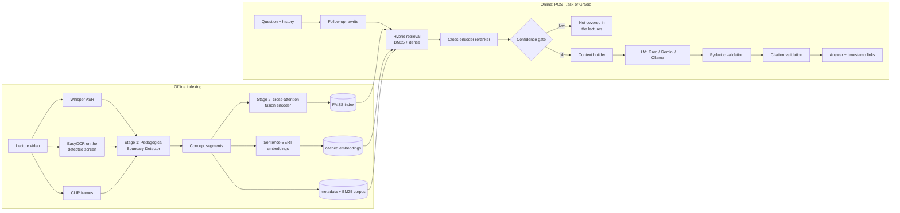

# ConceptBound

**Ask questions about hour-long lecture recordings and get answers grounded in the lectures, with clickable `[Lecture 3, 12:45]` citations that open the video at the exact moment.**


> **Live demo:** _coming soon (Hugging Face Space)_ · **Demo video:** _coming soon_
>
> 
> _(demo GIF placeholder)_

ConceptBound is a multimodal lecture-video search engine with a retrieval-augmented generation (RAG) layer. It reads what was **said** (Whisper), what was **on the slide** (EasyOCR) and what the frame **looks like** (CLIP); it cuts each lecture into concept-sized segments with a trained boundary detector; and it lets students ask free-text questions. Answers come only from the retrieved lecture moments, every citation is validated, and questions the lectures don't cover are refused instead of guessed.

B.Tech final-year project, Department of Computer Science and Engineering (AI & ML).

---

## Quick start: run the demo in 5 steps

You need Python 3.10+ and the prebuilt index in `data/rag_index/` (the course team has it; see [Data and models](#data-and-models) to build your own).

1. **Get the code and a virtual environment:**
   ```bash
   git clone https://github.com/marshallmathers0/Concept-Bound-Capstone.git
   cd Concept-Bound-Capstone
   python -m venv .venv
   ```
2. **Install the dependencies:**
   ```bash
   .venv\Scripts\python.exe -m pip install -r requirements.txt
   ```
   On macOS/Linux use `.venv/bin/python` here and below.
3. **Add a free LLM key (optional, but needed for written answers):**
   ```bash
   copy .env.example .env
   ```
   Then put `LLM_PROVIDER=groq` and `GROQ_API_KEY=<your key from console.groq.com/keys>` in `.env`.
4. **Start the demo:**
   ```bash
   .venv\Scripts\python.exe space\app.py
   ```
5. **Open http://127.0.0.1:7860** and ask, for example, *"Why is softmax used at the output layer?"*

Without a key the demo runs in retrieval-only mode and shows the most relevant lecture moments. Stop it with `Ctrl+C`. If it misbehaves, see [Troubleshooting](#troubleshooting). Full details for every part (API, tests, evaluation, rebuilding from raw videos) follow below, and in [DEVLOG.md, Part II](DEVLOG.md#part-ii-running-the-project).

---

## Table of contents

- [Quick start: run the demo in 5 steps](#quick-start-run-the-demo-in-5-steps)
- [Features](#features)
- [How it works](#how-it-works)
- [Tech stack](#tech-stack)
- [Project structure](#project-structure)
- [Getting started](#getting-started)
- [Usage](#usage)
- [API reference](#api-reference)
- [Evaluation results](#evaluation-results)
- [Running the tests](#running-the-tests)
- [Deployment (Hugging Face Spaces)](#deployment-hugging-face-spaces)
- [Troubleshooting](#troubleshooting)
- [Data, privacy and licensing](#data-privacy-and-licensing)
- [Limitations and roadmap](#limitations-and-roadmap)
- [Documentation](#documentation)
- [Contributing](#contributing)
- [License](#license)
- [Acknowledgments](#acknowledgments)

---

## Features

- **Ask in plain English.** "Why do we use softmax at the output layer?" returns an answer with citations to the exact lecture moments.
- **Clickable timestamps.** Each citation shows a snippet and a video player that starts at the cited second.
- **Concept-aware segmentation.** A trained *Pedagogical Boundary Detector* splits lectures where concepts change, not every 60 seconds.
- **Multimodal understanding.** Speech transcript, slide text and visual features, fused by a cross-attention encoder.
- **Hybrid retrieval.** BM25 + Sentence-BERT dense search, with an optional cross-encoder reranker.
- **Refuses instead of hallucinating.** A calibrated confidence gate answers *"This isn't covered in the indexed lectures"* for off-topic questions; citations the model invents are removed.
- **Follow-up questions.** "Explain it more simply" understands what "it" refers to.
- **Pluggable LLMs.** Groq (default `openai/gpt-oss-20b`), Google Gemini or local Ollama, chosen by an environment variable; it works without any key in retrieval-only mode.
- **Measured, not claimed.** A built-in evaluation produces Recall@k, MRR, nDCG, refusal accuracy and latency.
- **Runs on a CPU.** Heavy processing happens offline; the app loads precomputed indexes and starts in seconds.

## How it works



1. **Feature extraction** (offline, every 3 s): Whisper transcript (forced English, hallucination filtering), OCR inside the automatically detected projector screen, CLIP embeddings and optical flow.
2. **Stage 1, the boundary detector:** a BiLSTM/CNN/Transformer encoder trained with a contrastive margin loss + segment InfoNCE. Boundaries are where neighbouring embeddings differ; segments are kept between 60 and 600 s.
3. **Stage 2, segment fusion:** slide text, transcript and visual embeddings are fused by self-attention into one vector per segment and indexed with FAISS.
4. **Retrieval:** hybrid BM25 + Sentence-BERT, optional cross-encoder reranking of the top 20.
5. **RAG:**
   - A confidence gate refuses low-confidence questions.
   - The context builder labels segments `[S1]…[S5]` within a token budget.
   - The LLM answers in JSON, validated with Pydantic.
   - Invalid citations are dropped, and valid ones become `[Lecture, mm:ss]` links.

The full technical walkthrough, design reasons and build history are in **[DEVLOG.md](DEVLOG.md)**.

## Tech stack

| Area | Tools |
|---|---|
| Speech, vision, OCR | OpenAI Whisper, CLIP (ViT-B/32), EasyOCR, OpenCV |
| Models and training | PyTorch (BiLSTM / CNN / Transformer encoders, cross-attention fusion, InfoNCE) |
| Retrieval | FAISS, rank-bm25, Sentence-Transformers (`all-MiniLM-L6-v2`), cross-encoder `ms-marco-MiniLM-L-6-v2` |
| LLM | Groq, Google Gemini, Ollama (plain HTTP clients, retries with backoff) |
| Validation | Pydantic |
| Serving | FastAPI, Uvicorn, Gradio |
| Evaluation | Recall@k, MRR, nDCG@10, bootstrap CIs, Pk/WindowDiff, LLM-as-judge |
| Testing | pytest (LLM mocked, no network) |

## Project structure

```
ConceptBound/
├── app/
│   ├── backend/main.py         # FastAPI: POST /ask, GET /health, GET /api/search
│   └── frontend/index.html     # simple search page
├── space/
│   ├── app.py                  # Gradio demo
│   ├── prepare_space.py        # packages a Hugging Face Space
│   └── requirements.txt        # pinned, CPU-only
├── src/
│   ├── feature_extraction/     # Whisper, OCR + screen detection, CLIP, optical flow
│   ├── stage1_boundary/        # boundary detector: model, losses, training, segmentation
│   ├── stage2_retrieval/       # fusion encoder, training, FAISS, base hybrid retriever
│   ├── retrieval/              # search service, reranker, confidence
│   ├── rag/                    # index build, context, prompts, schema, citations, pipeline
│   ├── llm/                    # LLMClient + Groq / Gemini / Ollama / mock
│   ├── evaluation/             # research metrics and benchmark harness
│   └── utils/
├── eval/                       # RAG evaluation: questions, metrics, judge, runner
├── scripts/                    # extraction, training, annotation tools, ablations
├── tests/                      # pytest suite
├── docs/ANNOTATION_GUIDELINES.md
├── reports/eval_results.md     # latest evaluation report
├── paper/                      # research paper draft (ICALT 2027)
├── config.py                   # all paths and hyperparameters
├── requirements.txt
├── .env.example
├── DEVLOG.md                   # deep dive, build log, interview prep
└── MANUAL_TASKS.md             # open tasks that need a human
```

## Getting started

### Prerequisites

- **Python 3.10+** (developed and tested on 3.12)
- **ffmpeg** on your `PATH` (Whisper needs it to read audio)
- **About 16 GB RAM** for feature extraction (it holds a lecture's sampled frames in memory); the demo itself needs much less
- A GPU is optional; everything runs on CPU, extraction is just slow (minutes per lecture)
- Optional: a free **Groq** or **Gemini** API key for written answers

### Installation

```bash
git clone https://github.com/marshallmathers0/Concept-Bound-Capstone.git
cd Concept-Bound-Capstone
python -m venv .venv
# Windows
.venv\Scripts\activate
# macOS / Linux
source .venv/bin/activate
pip install -r requirements.txt
```

### Configuration

```bash
cp .env.example .env        # Windows: copy .env.example .env
```

Then edit `.env`:

```ini
LLM_PROVIDER=groq          # groq | gemini | ollama | none
GROQ_API_KEY=your_key      # https://console.groq.com/keys
# GEMINI_API_KEY=...       # https://aistudio.google.com/apikey
```

Without a key, everything still runs in **retrieval-only mode**: you get the most relevant lecture moments, but no written answer.

### Data and models

The repository **does not include** lecture videos, extracted features, model checkpoints or the search index. The recordings used in development are internal classroom recordings (see [Data, privacy and licensing](#data-privacy-and-licensing)). To run the project on your own lectures:

```bash
# 1. Put your lecture videos (.mp4/.mkv/...) in data/raw_videos/

# 2. Extract features, train both stages and build the base index (slow: Whisper + OCR + CLIP)
python scripts/run_full_pipeline.py

# 3. Build the RAG index for the demo (reuses the features; no Whisper/OCR here)
python -m src.rag.build_index --limit 5
```

Optionally, describe each video in `data/video_meta.json` (title, YouTube URL, licence, attribution). A YouTube URL makes citations embed the YouTube player at the timestamp.

## Usage

### Gradio demo

```bash
python space/app.py
```

Open http://127.0.0.1:7860, then:

- type a question or click an example;
- tick **Show retrieved segments** to see the retrieval scores;
- switch the reranker on or off;
- ask a follow-up like "explain it more simply".

### API server

```bash
uvicorn app.backend.main:app --port 8000
```

Interactive docs are at http://127.0.0.1:8000/docs.

### Command-line examples

```bash
curl -X POST http://localhost:8000/ask -H "Content-Type: application/json" \
     -d "{\"question\": \"Why is softmax used at the output layer?\"}"

curl "http://localhost:8000/api/search?q=gradient%20descent&top_k=5"
```

### Evaluation

```bash
python -m eval.make_questions      # builds eval/questions.jsonl
python -m eval.run                 # writes reports/eval_results.md
```

### Research pipeline (training, ablations, paper)

```bash
python scripts/make_splits.py                          # lecture-level train/val/test split
python -m src.stage1_boundary.train --epochs 30        # Stage 1
python scripts/segment_videos.py && python scripts/prepare_segment_features.py
python scripts/generate_pseudo_queries.py
python -m src.stage2_retrieval.train --epochs 20 --fusion-mode cross_attention   # or concat / pairwise
python scripts/run_evaluation.py --split test --rerank # all segmenters x retrievers, on human gold data
python scripts/run_ablations.py --split test           # signals, encoder, fusion, length, seeds
python scripts/run_paper_pipeline.py                   # everything above + rebuild the paper
```

Annotation workflow: `python scripts/make_annotation_sheets.py --annotator A1`, then follow [docs/ANNOTATION_GUIDELINES.md](docs/ANNOTATION_GUIDELINES.md), then `python scripts/validate_annotations.py`.

## API reference

### `POST /ask`

Request:

```json
{
  "question": "How does a bigram model generate a sentence?",
  "history": [{"role": "user", "content": "what is an n-gram model"}],
  "use_reranker": true,
  "top_k": 5
}
```

Response (abridged):

```json
{
  "answer": "It starts from a start token and repeatedly samples the next word ... [Lecture 5, 15:21]",
  "citations": [{"segment_id": "college_lec05#008", "display": "[Lecture 5, 15:21]",
                 "url": "/videos/college_lec05.mp4#t=921", "snippet": "..."}],
  "refused": false,
  "confidence": 0.86,
  "mode": "rag",
  "latency_ms": {"retrieval_ms": 41.0, "rerank_ms": 1840.0, "llm_ms": 620.0, "total_ms": 2510.0}
}
```

The response above is illustrative. `mode` is one of:

| `mode` | Meaning |
|---|---|
| `rag` | Grounded answer |
| `retrieval_only` | No LLM configured; top moments only |
| `refused` | The lectures don't cover the question |
| `llm_error` | Provider error or unparseable output; top moments returned |

### Other endpoints

| Endpoint | Purpose |
|---|---|
| `GET /health` | Whether the index, reranker and LLM are ready |
| `GET /api/search?q=...&top_k=5` | Original search endpoint: ranked lecture moments |
| `GET /api/stats` | Index statistics |

## Evaluation results

Produced by `python -m eval.run` on **157 segments from 5 one-hour lectures**, with 66 in-scope questions (49 drafted from the transcripts and *not yet human-verified*, plus 17 written by students) and 10 out-of-scope questions. CPU only. Full report: [reports/eval_results.md](reports/eval_results.md).

**Retrieval ablation (all 66 in-scope questions)**

| System | Recall@5 | Recall@10 | MRR | nDCG@10 | p50 latency |
|---|---|---|---|---|---|
| BM25 only | 0.637 | 0.743 | 0.613 | 0.588 | 8 ms |
| Dense (Sentence-BERT) only | 0.576 | 0.714 | 0.549 | 0.544 | 12 ms |
| Dense (fusion encoder) only | 0.221 | 0.379 | 0.202 | 0.226 | 12 ms |
| Hybrid (BM25 + Sentence-BERT) | **0.673** | 0.764 | 0.633 | 0.611 | 12 ms |
| Hybrid + reranker (original input order) | 0.524 | 0.686 | 0.556 | 0.535 | 2.5 s |
| Hybrid + reranker (transcript-first input) | 0.642 | **0.777** | **0.666** | **0.623** | 1.8 s |

**Human-written questions only (17):**

| System | MRR |
|---|---|
| Hybrid | **0.630** |
| BM25 | 0.596 |
| Hybrid + reranker | 0.521 |

**Refusal gate** (threshold calibrated on dev questions, measured on 29 held-out questions):

| Confidence source | Balanced accuracy | Out-of-scope refused | In-scope wrongly refused |
|---|---|---|---|
| Reranker probability | 1.00 | 100% | 0% |
| Dense similarity | 0.875 | 75% | 0% |

**Generation metrics** (faithfulness, citation accuracy, LLM latency) are **not reported yet**: they need an API key and appear in the report after `python -m eval.run` runs with one.

**What the numbers show:**
- **Hybrid beats either retriever alone.**
- **The reranker's gain depends on how its input is built,** and it does not help on the human-written questions yet, so it is switchable.
- **The fusion encoder needs retraining** on real questions.

The analysis is in [DEVLOG.md, Part VII](DEVLOG.md#part-vii-results).

## Running the tests

```bash
python -m pytest tests -q
```

The suite has 33 tests and takes about 30 seconds. The LLM is mocked, so there are no API calls. It covers:

- retrieval on the built index (skipped if no index exists);
- citation validation dropping fake IDs;
- refusal on low confidence;
- parsing malformed LLM output;
- retries and backoff;
- the Groq retired-model fallback;
- follow-up detection (real follow-ups vs standalone "why/how" questions);
- follow-up rewriting and the context budget.

## Deployment (Hugging Face Spaces)

The free **CPU basic** tier is enough. The heavy work (Whisper, OCR, both models) happens offline, so the Space only needs the inference code, the index (about 0.9 MB) and the Stage 2 checkpoint (about 8 MB): **about 9.4 MB in total, with no video files.**

**About the videos.** The development lectures are internal college recordings, which can't be published, so the deployed demo is **text-only**: each citation shows `[Lecture 1, 48:33]`, the quote from that moment, and a note to open the lecture at that time in the course material. Answers, retrieval and refusal work exactly as locally. For openly licensed lectures, put a YouTube link in each entry's `url` in `data/video_meta.json` and re-package; citations then embed the player at the cited second.

1. **Package the Space:**

   ```bash
   .venv\Scripts\python.exe space\prepare_space.py --allow-internal-videos --license other
   ```

   This creates `build/hf_space/` with the inference code (an explicit allow-list, so `.env` and `data/` can't leak), the index, the checkpoint, pinned CPU-only requirements and a Space README. By default it **refuses** lectures marked internal; `--allow-internal-videos` is the explicit "we have permission" switch. For openly licensed lectures, drop the flag.
2. **Optional: test the package locally** (PowerShell, port 7861):

   ```powershell
   cd build\hf_space
   $env:GRADIO_SERVER_PORT = "7861"; ..\..\.venv\Scripts\python.exe app.py
   ```
3. **Create the Space.** On huggingface.co choose **New Space**, name it `conceptbound`, SDK **Gradio**, hardware **CPU basic (free)**, visibility **Public**.
4. **Add the key.** Under **Settings → Variables and secrets**, add the **secret** `GROQ_API_KEY` and the **variable** `LLM_PROVIDER=groq`. Secrets are encrypted and injected as environment variables; never commit a key.
5. **Create a write token** at huggingface.co/settings/tokens (type **Write**). Git asks for it as the password.
6. **Push the folder:**

   ```bash
   cd build/hf_space
   git init -b main
   git remote add origin https://huggingface.co/spaces/<your-username>/conceptbound
   git add . && git commit -m "ConceptBound demo"
   git push -u origin main --force
   ```

   `--force` replaces the starter README Hugging Face creates in a new Space.
7. **Wait for the build** (about 5–10 minutes). When the page shows **Running**, the demo is live at `https://huggingface.co/spaces/<your-username>/conceptbound`.

**To update the live site,** re-run step 1, then `git add . && git commit -m "Update" && git push` inside `build/hf_space`.

**Good to know:**
- Groq's free tier allows 8,000 tokens per minute, shared by all visitors. Under heavy use, some visitors get the "showing the most relevant lecture moments" fallback.
- A free Space sleeps after about 48 hours without visitors; the next visitor waits about a minute.
- If the build fails, the Space's **Logs** tab shows the error.

The full deployment write-up (design decisions, alternatives considered, checklist) is in [DEVLOG.md, Part IV](DEVLOG.md#part-iv-deployment).

## Troubleshooting

| Symptom | Fix |
|---|---|
| `Groq request failed (HTTP 404) … model_not_found` | Groq retired the model. The client now switches automatically; remove any old `LLM_MODEL` line from `.env` and **restart the app** (a running app keeps its old code). |
| "The language model is unavailable … rate limit (HTTP 429)" | Groq's free tier limit (8,000 tokens per minute). Wait a minute; the app shows the most relevant moments meanwhile. |
| "No LLM is configured" | Add `LLM_PROVIDER` and `GROQ_API_KEY` to `.env`, then restart. |
| `ConnectionResetError [WinError 10054]` in the terminal | Harmless Windows message when a browser drops a connection; silenced in the demo. |
| Port 7860 already in use | Another copy is running. Close it or set `GRADIO_SERVER_PORT=7861`. |
| `RAG pipeline not available` from the API | Build the index: `python -m src.rag.build_index`. |

## Data, privacy and licensing

- **Development recordings are private.** They are classroom recordings from the authors' college and are not distributed. Videos, features, transcripts, indexes and checkpoints are excluded by `.gitignore`.
- **Students are visible and audible.** Annotate a `lecture_span` so indexing drops pre-class chatter and attendance roll calls.
- **Public demos need openly licensed lectures or written permission.** `space/prepare_space.py` refuses internal lectures unless `--allow-internal-videos` is passed, and never ships video files; it writes per-lecture attribution into the Space README.
- **The deployed index contains transcripts,** so anything said in class (including by students) inside the lecture span can appear in answers.

## Limitations and roadmap

**Current limitations:**
- one course and camera setup;
- a small evaluation set (most questions not yet human-verified);
- a fusion encoder trained on automatic pseudo-queries;
- no generation metrics until an API key is added;
- LLM-as-judge has known biases.

**Roadmap:**
- [ ] Human-verify the evaluation questions; annotate concept boundaries; add a second annotator
- [ ] Report generation metrics (faithfulness, citation accuracy)
- [ ] Retrain the fusion encoder on human questions; re-run the fusion ablation (cross-attention vs concat vs pairwise)
- [ ] Index the full course (~30 lectures)
- [ ] Public Hugging Face demo on openly licensed lectures
- [ ] Small user study on time-to-answer

## Documentation

| File | What's inside |
|---|---|
| [DEVLOG.md](DEVLOG.md) | How to run it, how everything works and why (with key source code), deployment, the day-by-day build log, results, lessons, interview Q&A |
| [docs/ANNOTATION_GUIDELINES.md](docs/ANNOTATION_GUIDELINES.md) | How to annotate lectures |
| [eval/README.md](eval/README.md) | The evaluation set and how to verify it |
| [reports/eval_results.md](reports/eval_results.md) | Latest measured results |
| [MANUAL_TASKS.md](MANUAL_TASKS.md) | Open tasks that need a human |
| [paper/README.md](paper/README.md) | Research paper draft |

## Contributing

Issues and pull requests are welcome. Please run `python -m pytest tests -q` before opening a PR, and never commit lecture videos, transcripts, indexes or API keys.

## License

No open-source licence has been chosen yet, so all rights are reserved by the authors for now. If you'd like to use the code, please open an issue.

## Acknowledgments

- **Base paper:** P. Arora, S. Pehlivan and J. Laaksonen, *Text-to-Multimodal Retrieval with Bimodal Input Fusion in Shared Cross-Modal Transformer*, LREC-COLING 2024.
- **Open-source tools:** OpenAI Whisper, OpenAI CLIP, EasyOCR, Sentence-Transformers, FAISS, rank-bm25, FastAPI and Gradio.
- **Our faculty guide and department,** for guidance and access to the recordings.
