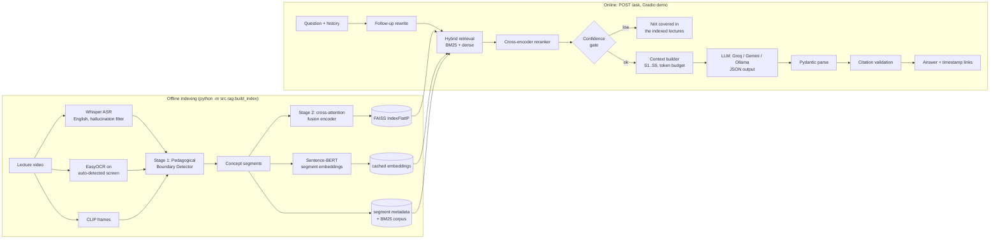

# ConceptBound-Net

**Ask questions about hour-long lecture recordings and get answers grounded in the lectures, with clickable `[Lecture 3, 12:45]` citations that open the video at the right moment.**

> Live demo: _[Hugging Face Space link — add after deployment]_ · Demo video: _[link]_
>
>  _(GIF placeholder: record the Gradio app answering one question with citations)_

ConceptBound is a multimodal lecture search engine (Whisper + EasyOCR + CLIP, a trained concept-boundary detector, a cross-attention segment encoder, FAISS + BM25 hybrid retrieval) with a retrieval-augmented generation layer on top. The LLM may only use retrieved lecture segments: answers are refused when retrieval confidence is low, and every citation is validated against what was actually retrieved.

B.Tech final-year project, Department of CSE (AI & ML). Interview guide: **[LEARNING.md](LEARNING.md)**.

## Architecture



| Folder | What lives there |
|---|---|
| `src/feature_extraction/`, `src/stage1_boundary/`, `src/stage2_retrieval/` | Original research pipeline (features, boundary detector, fusion encoder, existing hybrid retriever) |
| `src/rag/` | Offline index build, context builder, prompts, Pydantic schema, citation validation, follow-up rewrite, pipeline |
| `src/retrieval/` | Search service over the existing retriever + cross-encoder reranker + confidence |
| `src/llm/` | `LLMClient` interface; Groq, Gemini, Ollama, mock; retries/backoff |
| `eval/` | Question set, metrics, LLM-as-judge, `python -m eval.run` |
| `app/backend/` | FastAPI: `POST /ask`, `GET /health`, existing `/api/search` |
| `space/` | Gradio demo + Hugging Face Space packaging |
| `tests/` | pytest suite (LLM mocked, no network) |

## Quickstart (local)

```bash
python -m venv .venv && .venv\Scripts\activate     # Windows (source .venv/bin/activate on Linux/macOS)
pip install -r requirements.txt gradio pytest
copy .env.example .env                              # then add GROQ_API_KEY or GEMINI_API_KEY (optional)
python -m src.rag.build_index --ids college_lec01 college_lec02 college_lec03 college_lec04 college_lec05
python space/app.py                                 # Gradio demo on http://127.0.0.1:7860
uvicorn app.backend.main:app --port 8000            # API: POST /ask, GET /health
python -m pytest tests -q                           # tests (no API calls)
python -m eval.run                                  # evaluation -> reports/eval_results.md
```

Example API call:

```bash
curl -X POST http://localhost:8000/ask -H "Content-Type: application/json" \
     -d "{\"question\": \"Why is softmax used at the output layer?\"}"
```

Without an API key everything still runs: the app returns the most relevant lecture moments (retrieval-only mode) and the eval reports retrieval and refusal-gate metrics but marks generation metrics as not run.

## Evaluation results

Measured with `python -m eval.run` on 157 segments from 5 one-hour lectures: 66 in-scope questions (49 drafted from the transcripts and **not yet human-verified**, 17 human-written) and 10 out-of-scope questions. Full report: [reports/eval_results.md](reports/eval_results.md). CPU only.

**All in-scope questions (n=66)**

| System | Recall@5 | Recall@10 | MRR [95% CI] | nDCG@10 | latency p50 / p95 (ms) | n |
|---|---|---|---|---|---|---|
| BM25 only | 0.637 | 0.743 | 0.613 [0.52, 0.70] | 0.588 | 8 / 9 | 66 |
| Dense (Sentence-BERT) only | 0.576 | 0.714 | 0.549 [0.45, 0.65] | 0.544 | 12 / 14 | 66 |
| Dense (fusion encoder) only | 0.221 | 0.379 | 0.202 [0.13, 0.28] | 0.226 | 12 / 14 | 66 |
| Hybrid (BM25 + Sentence-BERT) | 0.673 | 0.764 | 0.633 [0.54, 0.72] | 0.611 | 12 / 14 | 66 |
| Current app mode ('auto') | 0.673 | 0.764 | 0.633 [0.54, 0.72] | 0.611 | 19 / 22 | 66 |
| Hybrid + reranker, OCR-first input (original) | 0.524 | 0.686 | 0.556 [0.46, 0.66] | 0.535 | 2466 / 3817 | 66 |
| Hybrid + reranker, transcript-first input | 0.642 | 0.777 | 0.666 [0.58, 0.76] | 0.623 | 1840 / 2283 | 66 |

**Human-written questions only (n=17)**: the more realistic subset, with wide confidence intervals

| System | Recall@5 | Recall@10 | MRR [95% CI] | nDCG@10 | latency p50 / p95 (ms) | n |
|---|---|---|---|---|---|---|
| BM25 only | 0.582 | 0.717 | 0.596 [0.40, 0.79] | 0.583 | 8 / 9 | 17 |
| Dense (Sentence-BERT) only | 0.443 | 0.568 | 0.450 [0.26, 0.65] | 0.442 | 12 / 14 | 17 |
| Dense (fusion encoder) only | 0.093 | 0.227 | 0.108 [0.05, 0.18] | 0.118 | 12 / 14 | 17 |
| Hybrid (BM25 + Sentence-BERT) | 0.597 | 0.707 | 0.630 [0.44, 0.82] | 0.590 | 12 / 14 | 17 |
| Current app mode ('auto') | 0.597 | 0.707 | 0.630 [0.44, 0.82] | 0.590 | 19 / 22 | 17 |
| Hybrid + reranker, OCR-first input (original) | 0.444 | 0.730 | 0.508 [0.31, 0.71] | 0.529 | 2466 / 3817 | 17 |
| Hybrid + reranker, transcript-first input | 0.460 | 0.760 | 0.521 [0.35, 0.69] | 0.527 | 1840 / 2283 | 17 |

**Refusal gate** (threshold calibrated on dev questions, reported on held-out ones):

- **without reranker** (confidence source: dense): threshold 0.320 chosen on 30 dev questions (balanced accuracy 1.000). On 29 held-out questions: balanced accuracy **0.875**, out-of-scope refused **0.750**, in-scope wrongly refused 0.000.
- **with reranker** (confidence source: rerank): threshold 0.001 chosen on 30 dev questions (balanced accuracy 1.000). On 29 held-out questions: balanced accuracy **1.000**, out-of-scope refused **1.000**, in-scope wrongly refused 0.000.

**Generation metrics (faithfulness, citation accuracy, end-to-end refusal, LLM latency): not run yet.** No LLM API key was available on the development machine. Set `GROQ_API_KEY` or `GEMINI_API_KEY` and re-run `python -m eval.run`; nothing is reported until then.

What the numbers say:
- **Hybrid retrieval beats either retriever alone** (MRR 0.633 vs 0.613 BM25 and 0.549 dense), and it is what the app's `auto` mode uses in practice.
- **The reranker's input order matters a lot.** With noisy OCR text first, reranking made things worse (MRR 0.556). Transcript-first fixed it (MRR 0.666, Recall@10 0.777), but that fix was found on this same question set, so treat the gain as optimistic.
- **On the 17 human-written questions the reranker does not help** (MRR 0.521 vs 0.630 for hybrid), and it costs about 1.8 s per query on CPU. It is kept switchable for that reason.
- **The fusion encoder is weak** (MRR 0.20): it was trained on automatic pseudo-queries before the data fixes. Retraining on human questions is the next step.


## Deploy to Hugging Face Spaces (free CPU)

1. **Use openly licensed lectures for a public demo.** The college recordings in this repo are internal and contain students. Pick 3–5 lectures with a reuse licence (e.g. MIT OpenCourseWare on YouTube, CC BY-NC-SA 4.0). Put the files in `data/raw_videos/`, and add their title, YouTube URL, licence and attribution to `data/video_meta.json`.
2. Build the index offline: `python -m src.rag.build_index --ids <your ids> --extract-missing` (Whisper/OCR run here, once).
3. Package: `python space/prepare_space.py` → `build/hf_space/` (code, index, checkpoint, pinned `requirements.txt`, Space README with attribution). The script refuses to package lectures marked internal.
4. Create a Space at huggingface.co → New Space → SDK **Gradio**, hardware **CPU basic (free)**.
5. Push: `cd build/hf_space && git init && git remote add origin https://huggingface.co/spaces/<user>/conceptbound && git add . && git commit -m "ConceptBound demo" && git push -u origin main` (use a Hugging Face access token with write permission as the password).
6. In the Space → Settings → **Variables and secrets**, add secret `GROQ_API_KEY` (or `GEMINI_API_KEY`) and variable `LLM_PROVIDER=groq`. The Space rebuilds automatically.
7. First start takes a few minutes (dependency install + model download), then about 20 s per restart.

## Data, licensing and privacy

- The five indexed lectures are recordings of an undergraduate course at the authors' college, used internally with permission pending (see `MANUAL_TASKS.md`). They must not be redistributed, and they are excluded from git (`data/rag_index/` is ignored).
- One recording includes a roll call with student names. Annotate `lecture_span` in `data/annotations/gold/` (or `data/video_meta.json`) so `build_index` drops anything outside teaching time.
- For the public demo, list every lecture's source, licence and attribution in `data/video_meta.json`; `prepare_space.py` copies them into the Space README.

---

# Research pipeline (training, evaluation, paper)

## Concept-Aware Retrieval of Lecture Video Moments
### using a Pedagogical Boundary Detector and Cross-Modal Segment Fusion

B.Tech Final Year Project — Department of Computer Science and Engineering (AI & ML)
Domain: Multimodal Video Retrieval / Educational Technology

---

## 1. What this project does

Given a long, single-camera lecture video (or a whole course playlist of them), this
system:

1. **Segments** each lecture into *concept-coherent* moments (e.g. "gradient
   descent derivation", "backpropagation worked example") using a trainable
   **Pedagogical Boundary Detector** (Stage 1), instead of fixed 60-second
   windows or generic shot-cut detection.
2. **Indexes** every segment with a trainable **Cross-Modal Segment Fusion
   Encoder** (Stage 2) that fuses on-screen board/slide text (OCR), spoken
   transcript (ASR), and visual keyframe content (CLIP) into one embedding
   per segment, stored in a FAISS vector index.
3. **Serves free-text queries** — a student types *"explain backpropagation
   with an example"* and gets back a ranked list of (video, timestamp range)
   results with a "jump to moment" link, via a FastAPI backend + simple web
   frontend.

The two trainable components are:

| Component | File | Objective |
|---|---|---|
| Pedagogical Boundary Detector | `src/stage1_boundary/model.py` | Self-supervised contrastive boundary loss (margin loss + segment InfoNCE) |
| Segment Fusion Encoder + Query Projector | `src/stage2_retrieval/fusion_model.py` | Symmetric InfoNCE contrastive loss on (query, segment) pairs |

Everything else (OCR, ASR/Whisper, Sentence-BERT, CLIP, FAISS) is **frozen,
pretrained** and used purely for feature extraction.

---

## 2. Project structure

```
lecture_retrieval/
├── config.py                      # central configuration (paths, dims, hyperparameters)
├── requirements.txt
├── data/
│   ├── raw_videos/                 # <-- put your .mp4/.mkv lecture files here
│   ├── features/                   # per-video fused feature streams (.npz)
│   ├── segments/                   # Stage-1 segment boundaries (.json) + Stage-2 segment features (.npz)
│   ├── annotations/                # manual ground-truth: boundaries + (query, segment) pairs
│   └── index/                      # FAISS index + metadata
├── checkpoints/                    # trained model weights
├── src/
│   ├── feature_extraction/         # OCR, ASR+topic-drift, visual-change, CLIP
│   ├── stage1_boundary/            # Pedagogical Boundary Detector: model, losses, pseudo-labels, train, segment
│   ├── stage2_retrieval/           # Segment Fusion Encoder, Query Projector, InfoNCE training, FAISS index, retrieval
│   ├── baselines/                  # fixed-window, shot-detection, sliding-window retrieval
│   ├── evaluation/                 # boundary F1/IoU, Recall@k / mean IoU
│   └── utils/                      # I/O helpers
├── app/
│   ├── backend/main.py             # FastAPI search API
│   └── frontend/index.html         # search UI
└── scripts/                        # orchestration scripts (see below)
```

---

## 3. Setup

```bash
python -m venv .venv
# macOS / Linux
source .venv/bin/activate
# Windows PowerShell
.\.venv\Scripts\Activate.ps1
pip install -r requirements.txt
```

> **Note:** `transformers` (CLIP) and `sentence-transformers` download pretrained
> weights from the internet on first use. Real lecture-video experiments need
> the actual pretrained encoders.

All scripts assume the project root is on `PYTHONPATH`. Either run them with
`python -m ...` from the project root, or:

```bash
# macOS / Linux
export PYTHONPATH=$(pwd)
# Windows PowerShell
$env:PYTHONPATH = Resolve-Path .
```

---

## 4. End-to-end pipeline (real lecture videos)

> **Ground rule:** results are only ever reported on **human gold
> annotations** of **held-out test lectures**. Pseudo-labels and
> pseudo-queries are training signal only: they are built from the system's
> own inputs, so scoring against them measures nothing.

### Step 0 — Place videos
Put the recorded lecture files (`.mp4/.mkv/.avi/.mov/.webm`) in
`data/raw_videos/`. Make sure you have written permission to use them.

### Step 1 — Feature extraction
```bash
python scripts/extract_features.py
```
For each video, samples frames every `FEATURES.time_step_sec` (default 3s)
and computes:
- OCR text + text-change rate (EasyOCR on the **projected screen**, found
  automatically per 5-minute chunk; override per video in
  `data/ocr_regions.json` as `{"<video_id>": [x0, y0, x1, y1]}` in 0–1 units)
- ASR transcript (Whisper, with hallucination filtering) + topic-drift signal
- Visual-change rate (optical flow)
- CLIP image embedding of the sampled frame

Output: `data/features/<video_id>.npz`, including the raw Whisper segments
(`asr_segments`) and a `provenance` record (OCR engine, crop source, OCR
coverage, Whisper model).

Extraction **fails loudly** if EasyOCR, Whisper or Sentence-BERT cannot load;
there are no silent empty or random fallbacks. If EasyOCR's own model download
stalls, fetch `craft_mlt_25k.zip` (release `pre-v1.1.6`) and
`english_g2.zip` (release `v1.3`) from
https://github.com/JaidedAI/EasyOCR/releases and unzip them into
`~/.EasyOCR/model/`.

To fix already-extracted files (OCR/ASR only, CLIP is kept):
```bash
python scripts/refresh_features.py --ocr --asr
```

### Step 2 — Freeze a video-level split
```bash
python scripts/make_splits.py          # add --groups data/video_meta.json to split by course
```
Writes `data/splits.json`. All training scripts exclude the test videos.
Never split by segment or query (neighbouring moments of one lecture would
end up in both train and test).

### Step 3 — Annotate gold data
```bash
python scripts/make_annotation_sheets.py --annotator A1
python scripts/validate_annotations.py
```
Follow [docs/ANNOTATION_GUIDELINES.md](docs/ANNOTATION_GUIDELINES.md). Each
annotator fills `data/annotations/gold/<video_id>.<annotator>.json`
(lecture span, concept boundaries, student-style queries with time ranges).
Double-annotate at least 20–25% of the videos. `validate_annotations.py`
reports inter-annotator agreement in `results/annotation_report.md`.

### Step 4 — Train Stage 1 (Pedagogical Boundary Detector)
```bash
python -m src.stage1_boundary.train --epochs 30 --encoder-type transformer --label-source auto
```
`--label-source auto` uses gold boundaries where a train video has them and
pseudo-labels elsewhere (`gold` / `pseudo` force one). The checkpoint is
selected by boundary F1 on gold val videos when they exist. Training logs go
to `results/stage1_train_log.json`.

### Step 5 — Segment all videos
```bash
python scripts/segment_videos.py
```
Writes `data/segments/<video_id>.json`. Segments are kept between
`STAGE1.min_segment_sec` (60s) and `STAGE1.max_segment_sec` (600s).

### Step 6 — Per-segment features and pseudo-queries
```bash
python scripts/prepare_segment_features.py
python scripts/generate_pseudo_queries.py
```
Pseudo-queries go to `data/annotations/<video_id>_pseudo_queries.json`
(training only, never evaluated on).

### Step 7 — Train Stage 2 (Segment Fusion Encoder + Query Projector)
```bash
python -m src.stage2_retrieval.train --epochs 20 --fusion-mode cross_attention
```
Add `--use-gold` to also train on gold queries of train-split videos. Use
`--fusion-mode concat` for the fusion ablation.

### Step 8 — Build the FAISS index (for the demo app)
```bash
python -m src.stage2_retrieval.index_builder
```

### Step 9 — Evaluate
```bash
python scripts/run_evaluation.py --split val      # develop and tune here
python scripts/run_evaluation.py --split test --rerank   # once, at the end
```
Compares, on gold data only:
- **Segmentation:** Stage 1 vs the pseudo-label heuristic, TextTiling-style
  topic drift, shot detection, and fixed 30/60/120s windows. Metrics: boundary
  F1 at ±15s/±30s, Pk, WindowDiff, mean IoU.
- **Retrieval:** every segmenter × {BM25, MiniLM, BGE, BM25+dense hybrid
  (RRF), cross-encoder re-ranking, trained fusion model}, plus gold
  segmentation as an oracle. Metrics: R@1/5/10, R@1 at IoU≥0.5, MRR,
  mIoU@1, 95% bootstrap CIs, paired significance against fixed-60s BM25, and a
  per-query-type breakdown.

Each run writes `results/<run>/results.md`, `summary.json` and
`per_query.jsonl` (rankings for error analysis).

### Step 10 — Run the demo web app
```bash
uvicorn app.backend.main:app --reload --port 8000
```
The demo uses `mode="auto"`, which falls back to BM25 + dense search when the
neural scores look degenerate. Evaluation never uses that switch.

### All in one
```bash
python scripts/run_full_pipeline.py
```

---

## 5. Notes on running your own lecture videos

Use the real video pipeline with files placed in `data/raw_videos/`.

1. Place your `.mp4/.mkv/.avi/.mov/.webm` files in `data/raw_videos/`
2. Extract features:
```bash
python scripts/extract_features.py
```
3. Segment videos with the trained Stage 1 model:
```bash
python scripts/segment_videos.py
```
4. Compute per-segment Stage-2 features:
```bash
python scripts/prepare_segment_features.py
```
5. Build the FAISS index:
```bash
python -m src.stage2_retrieval.index_builder
```
6. Run the demo app:
```bash
uvicorn app.backend.main:app --reload --port 8000
```

> If you do not have a trained model yet, train Stage 1 and Stage 2 first,
> or obtain the checkpoints `checkpoints/stage1_boundary_detector.pt` and
> `checkpoints/stage2_retrieval_model.pt`.

---

## 6. Mapping to the proposal

| Proposal section | Implementation |
|---|---|
| §4.1 Stage 1 — feature streams (OCR-Δ, transcript topic-drift, visual-Δ, CLIP) | `src/feature_extraction/*` |
| §4.1 Pedagogical Boundary Detector (1D-CNN / Transformer, contrastive boundary loss) | `src/stage1_boundary/model.py`, `losses.py` |
| §4.1 Pseudo-labels from signal peaks + manual annotation refinement | `src/stage1_boundary/pseudo_labels.py` |
| §4.2 Segment Fusion Encoder (cross-attention) | `src/stage2_retrieval/fusion_model.py` |
| §4.2 InfoNCE retrieval training | `src/stage2_retrieval/train.py` |
| §4.2 FAISS index + "jump to moment" | `src/stage2_retrieval/index_builder.py`, `retrieval.py`, `app/` |
| §5.2 Baselines (fixed-window, shot-detection, sliding-window retrieval) | `src/baselines/*` |
| §5.3 Ablations (signal removal, segmentation method, fusion strategy) | drop columns from `features` before Stage-1 training; swap `--fusion-mode` for Stage 2 |
| §5 Metrics (boundary F1/IoU, Recall@k, mean IoU) | `src/evaluation/*` |

### Running the ablations

- **Signal-removal ablation (Stage 1):** zero out one of the three scalar
  columns (`features[:, 0]`=OCR, `features[:, 1]`=topic-drift,
  `features[:, 2]`=visual) before training, and compare boundary F1/IoU.
- **Segmentation-method ablation (Stage 2):** run `prepare_segment_features.py`
  + Stage-2 training/indexing once using Stage-1 segments and once using
  `src/baselines/fixed_window.fixed_window_segments` as the segment
  boundaries, holding the retrieval architecture fixed.
- **Fusion-strategy ablation (Stage 2):** train with `--fusion-mode
  cross_attention` vs `--fusion-mode concat` and compare Recall@k.

---

## 7. Notes on scaling to real NPTEL/YouTube data

- `FEATURES.time_step_sec` (default 3s) and `FEATURES.clip_dim` /
  `FEATURES.text_embed_dim` in `config.py` should match your chosen
  EasyOCR/Whisper/CLIP/Sentence-BERT models. The training scripts also infer
  dimensions directly from the saved `.npz`/segment-feature files, so they
  remain correct even if you change these.
- For a 1–2 hour lecture at a 3-second step, expect `T ≈ 1200–2400`
  time-steps per video — the Transformer encoder in Stage 1 handles this
  comfortably on CPU for inference; for training on many such videos, a GPU
  is recommended.
- OCR is the most expensive step at scale; consider running it only every
  N-th sampled frame and interpolating, or cropping tightly to the
  board/slide region via `src/feature_extraction/ocr_extractor.board_region`.


---

## 8. How This Project Was Built — Day-by-Day Process

This section documents the actual human workflow used to build the project from scratch.
It is written so that anyone can reproduce or extend the work by following the same sequence of steps.

---

### Day 0 — Environment Setup & Repository Scaffold

**Goal:** Get a clean, reproducible Python environment and lay out the folder skeleton.

1. Create the project folder and initialise a Git repository:
   ```bash
   mkdir manoj_capstone && cd manoj_capstone
   git init
   ```

2. Create a virtual environment and activate it:
   ```bash
   python -m venv .venv
   # Windows PowerShell
   .\.venv\Scripts\Activate.ps1
   ```

3. Install core dependencies one group at a time, pinning versions as you go,
   and capture them in `requirements.txt`:
   ```
   torch torchvision
   transformers sentence-transformers
   openai-whisper
   faiss-cpu
   easyocr
   opencv-python-headless
   fastapi uvicorn
   rank-bm25 scikit-learn numpy
   ```

4. Create the top-level folder skeleton (`src/`, `data/`, `checkpoints/`, `app/`, `scripts/`) and add empty `__init__.py` files so everything is importable as a package.

5. Write `config.py` with a single source of truth for all paths, feature dimensions, and hyper-parameters using simple `dataclass`-style namespaces (`FEATURES`, `STAGE1`, `STAGE2`, `PATHS`).

6. Add `.gitignore` (exclude `.venv/`, `data/raw_videos/`, `checkpoints/*.pt`, `__pycache__/`).

7. Commit: `git commit -m "Day 0: environment + scaffold"`.

---

### Day 1 — Problem Scoping & Literature Review

**Goal:** Nail down exactly what the system needs to do before writing a single model.

1. Write out the problem statement in plain English:
   *"Given a long lecture video, find the segment most relevant to a free-text student query."*

2. Survey related work — skim papers on:
   - Temporal action / story segmentation (TextTiling, topic segmentation).
   - Video-language retrieval (CLIP4Clip, Frozen-in-Time, MMT).
   - Educational NLP (NPTEL lecture processing, MOOCRev).

3. Decide on the **two-stage architecture**:
   - Stage 1 separates *where* concept boundaries are.
   - Stage 2 separates *what* each segment talks about so queries can be matched.

4. List the modalities available in a lecture video and pick feature extractors:
   - OCR on board/slide frames → **EasyOCR**
   - Spoken transcript → **Whisper** (offline, no API cost)
   - Visual content → **CLIP** image encoder
   - Topic-drift signal → **Sentence-BERT** cosine distance on rolling transcript windows

5. Write the first draft of the proposal / design doc.

---

### Day 2 — Feature Extraction Pipeline

**Goal:** Turn raw `.mp4` lecture videos into structured `.npz` feature files.

1. Write `src/feature_extraction/ocr_extractor.py`:
   - Sample one frame every `time_step_sec` seconds with OpenCV.
   - Crop the board/slide region (`board_region` bounding box in `config.py`).
   - Run EasyOCR; compute a change-rate signal between consecutive frames.

2. Write `src/feature_extraction/asr_extractor.py`:
   - Wrap Whisper for offline transcription → list of `(start, end, text)` segments.
   - Implement rolling-window text assembly (`text_for_window`).
   - Encode windows with Sentence-BERT; compute cosine-distance topic-drift signal.
   - Add a TF-IDF pre-filter (`texttiling_prefilter`) so Sentence-BERT is only called at likely topic-change points — this cuts encoding calls significantly on stable stretches.

3. Write `src/feature_extraction/visual_extractor.py`:
   - Compute optical-flow magnitude between consecutive frames as a visual-change signal.
   - Encode each sampled frame with a frozen CLIP vision encoder.

4. Write `scripts/extract_features.py` to orchestrate all extractors and save one `.npz` per video to `data/features/`.

5. Test on a short (5-minute) sample lecture. Inspect the `.npz` arrays: verify shape `(T, D)`, check that OCR-change and topic-drift signals spike visually around real slide transitions.

6. Commit: `"Day 2: feature extraction pipeline"`.

---

### Day 3 — Stage 1 Model & Loss Design

**Goal:** Design and implement the Pedagogical Boundary Detector.

1. Decide on the task formulation: instead of a binary classifier, train an **embedding model** where embeddings of time-steps in the *same* concept segment are similar, and those across a boundary are dissimilar. This makes the score differentiable and avoids class-imbalance issues.

2. Write `src/stage1_boundary/model.py` with three interchangeable encoder backbones:
   - `CNNBoundaryEncoder` — stack of dilated 1D convolutions (fast, local context).
   - `TransformerBoundaryEncoder` — sinusoidal positional encoding + `nn.TransformerEncoder` (long-range context).
   - `BiLSTMBoundaryEncoder` — bidirectional LSTM with packed-sequence support for variable-length lectures.
   - Wrap all three in `PedagogicalBoundaryDetector` which L2-normalises output embeddings so cosine similarity reduces to a dot product.

3. Write `src/stage1_boundary/losses.py` with two complementary training objectives:
   - **Adjacent-pair margin loss**: pull same-segment neighbours together, push boundary-crossing pairs apart beyond a margin.
   - **Segment InfoNCE**: for each anchor time-step, sample one positive (same segment) and several negatives (different segments) to give the encoder a non-local supervisory signal.
   - Combine: `total_loss = margin_loss + 0.5 × infonce_loss`.

4. Write `src/stage1_boundary/pseudo_labels.py`:
   - Peak-detection on the raw OCR / topic-drift / visual-change signals to generate noisy but free pseudo-boundaries for self-supervised pre-training before any manual annotation is available.

5. Write `src/stage1_boundary/dataset.py` (`BoundaryDataset`) and a `collate_fn` that pads variable-length sequences and builds the `key_padding_mask` expected by the Transformer and Bi-LSTM encoders.

6. Commit: `"Day 3: Stage 1 model + contrastive boundary loss"`.

---

### Day 4 — Stage 1 Training & Segmentation

**Goal:** Train Stage 1 and turn its output into discrete `(start_time, end_time)` segments.

1. Write `src/stage1_boundary/train.py`:
   - Detect feature dimension from actual `.npz` files (no hard-coded assumption).
   - Train/val split on video IDs (not frames) to avoid data leakage.
   - Save best checkpoint by validation loss with `torch.save`.

2. Train on pseudo-labels first (`--epochs 30 --encoder-type bilstm`) to get a warm-start; then fine-tune on any manually annotated boundaries.

3. Write `src/stage1_boundary/segment.py`:
   - Load the trained model, run inference to get per-time-step boundary scores `b_t = 1 - cos_sim(z_t, z_{t+1})`.
   - Apply peak-finding (scipy or hand-rolled) with a minimum segment duration constraint to produce discrete boundary times.

4. Write `scripts/segment_videos.py` to run segmentation over all videos and save `data/segments/<video_id>.json`.

5. Visually inspect a few segmentations: jump to boundary times in the video and confirm they align with real slide/topic transitions.

6. Write `src/baselines/fixed_window.py` and `src/baselines/shot_detection.py` as comparison baselines.

7. Commit: `"Day 4: Stage 1 training loop + segmentation"`.

---

### Day 5 — Stage 2 Model Design

**Goal:** Design the Segment Fusion Encoder and Query Projector.

1. Decide the fusion strategy: treat the three per-segment modality embeddings (OCR text, ASR transcript, CLIP keyframe) as a *3-token sequence* and apply multi-head self-attention across them — this lets the model learn which modality is most informative per query rather than using a fixed weighting.

2. Write `src/stage2_retrieval/fusion_model.py`:
   - `ZScoreNorm`: normalise each modality to zero mean / unit variance per batch before fusion, so no modality dominates attention due to magnitude differences.
   - `SegmentFusionEncoder`: project each modality to `hidden_dim`, add learned modality-type embeddings, apply a Transformer block (attention + FFN + LayerNorm), mean-pool the 3 output tokens into one `z_seg` vector, L2-normalise.
   - Add `fusion_mode="concat"` as an ablation switch (skip attention; concatenate projections instead).
   - `QueryProjector`: two-layer MLP mapping a frozen Sentence-BERT query embedding into the same space as `z_seg`.
   - `CrossModalRetrievalModel`: bundle both modules for joint checkpointing.

3. Justify the architecture choices in the design doc:
   - Attention across 3 tokens is O(9) — completely negligible compute.
   - Z-score normalisation prevents the transcript embedding (largest magnitude) from drowning out the CLIP embedding.

4. Commit: `"Day 5: Stage 2 fusion model architecture"`.

---

### Day 6 — Segment Features, Training Data & Stage 2 Training

**Goal:** Build per-segment feature vectors, generate training pairs, and train Stage 2.

1. Write `src/stage2_retrieval/segment_features.py`:
   - For each segment, aggregate all OCR text into one string and encode with Sentence-BERT.
   - Aggregate ASR transcript similarly.
   - Average the CLIP frame embeddings across all time-steps in the segment as the visual embedding.
   - Save to `data/segments/<video_id>_segment_features.npz`.

2. Write `scripts/prepare_segment_features.py` to run the above over all videos.

3. Annotation strategy:
   - If manual `(query, segment)` pairs exist: use them (strongest signal).
   - If not: run `scripts/generate_pseudo_queries.py` — extract keywords from each segment's transcript / OCR text using TF-IDF, form a short query string, and use the source segment as the positive. This enables fully self-supervised end-to-end training.

4. Write `src/stage2_retrieval/train.py`:
   - Load segment feature `.npz` files and `(query, positive_segment)` pairs.
   - Encode queries with frozen Sentence-BERT.
   - Compute `z_query = QueryProjector(e_query)` and `z_seg = SegmentFusionEncoder(e_ocr, e_transcript, e_visual)`.
   - Apply **symmetric InfoNCE loss**: for each `(query, segment)` pair in the batch, all other segments are negatives for the query, and all other queries are negatives for the segment.
   - Train with AdamW; save best checkpoint.

5. Run an initial training sanity-check: does the InfoNCE loss decrease? Do learned embeddings cluster by topic when visualised with t-SNE on a small toy set?

6. Commit: `"Day 6: segment features + Stage 2 training"`.

---

### Day 7 — FAISS Indexing & Retrieval Engine

**Goal:** Index all segment embeddings and implement query-time search.

1. Write `src/stage2_retrieval/index_builder.py`:
   - Load the trained `CrossModalRetrievalModel`.
   - Encode every segment with `SegmentFusionEncoder`; store `z_seg` vectors.
   - Build a `faiss.IndexFlatIP` (inner-product index, works correctly for L2-normalised vectors).
   - Save index to `data/index/segments.index` and metadata (video ID, start/end times, raw text) to `data/index/segments_metadata.json`.

2. Write `src/stage2_retrieval/retrieval.py` — the `LectureRetriever` class:
   - Load FAISS index + metadata at startup.
   - Pre-compute Sentence-BERT embeddings for all segment texts at startup (one-time cost, enables sub-second fallback search).
   - Build a BM25 index (`rank_bm25.BM25Okapi`) over segment texts at startup.
   - `search()`:
     1. Encode the query with the trained `QueryProjector`.
     2. Run `faiss.index.search()` for top-k results.
     3. Apply **dynamic variance trigger**: if FAISS scores are all low (model untrained) or all identical (model collapsed), fall back to the hybrid BM25 + Sentence-BERT retriever.
     4. Otherwise, boost FAISS scores with a 30% text-similarity component for robustness.

3. Test retrieval interactively with a few sample queries against a small index; verify that timestamps are correct.

4. Commit: `"Day 7: FAISS index + retrieval engine with fallback"`.

---

### Day 8 — FastAPI Backend & Frontend

**Goal:** Wrap the retrieval engine in a web API and build a minimal search UI.

1. Write `app/backend/main.py`:
   - Instantiate `LectureRetriever` once at startup (singleton pattern via `@app.on_event("startup")`).
   - Expose `GET /search?q=<query>&top_k=5` → returns ranked JSON results with `jump_link` timestamps.
   - Serve `app/frontend/index.html` as a static file at `/`.

2. Write `app/frontend/index.html`:
   - Simple search box + results list.
   - Each result shows video ID, timestamp range, a snippet of OCR/transcript text, and a "Jump to moment" link that deep-links into the video at the correct second.

3. Test the full end-to-end flow locally:
   ```bash
   uvicorn app.backend.main:app --reload --port 8000
   ```
   Type a query, verify results appear and timestamps are sensible.

4. Commit: `"Day 8: FastAPI backend + search frontend"`.

---

### Day 9 — Evaluation Framework & Baselines

**Goal:** Measure model performance rigorously and compare against baselines.

1. Write `src/evaluation/boundary_eval.py`:
   - **Boundary F1**: for each predicted boundary, check whether a ground-truth boundary exists within a tolerance window (e.g., ±15 s). Compute precision, recall, F1.
   - **Mean IoU**: for each predicted segment, find the ground-truth segment with maximum IoU; average over all predictions.

2. Write `src/evaluation/retrieval_eval.py`:
   - **Recall@k**: for each ground-truth `(query, segment)` pair, check whether the correct segment appears in the top-k retrieved results.
   - **Mean IoU@1**: IoU between the top-1 retrieved segment and the ground-truth segment.

3. Run evaluation for all configurations:
   - Stage 1 vs. fixed-window vs. shot-detection baselines → boundary F1 / mean IoU.
   - Stage 2 (cross-attention) vs. Stage 2 (concat ablation) vs. sliding-window retrieval → Recall@1/5/10, mean IoU@1.

4. Write `scripts/run_evaluation.py` to print a clean results table.

5. Analyse failure cases: which query types does the model struggle with? Are there boundary-detection errors causing retrieval errors downstream?

6. Commit: `"Day 9: evaluation framework + baseline comparison"`.

---

### Day 10 — Ablation Studies & Final Polish

**Goal:** Run the ablations described in the proposal and wrap up.

1. **Signal-removal ablation (Stage 1):** zero out one scalar column at a time (`OCR-Δ`, `topic-drift`, `visual-Δ`) before training and compare boundary F1/IoU. This reveals which modality contributes most to boundary detection.

2. **Segmentation-method ablation (Stage 2):** train Stage 2 once with Stage-1 segments and once with fixed-window segments (holding everything else constant). This shows whether better segmentation improves retrieval.

3. **Fusion-strategy ablation (Stage 2):** compare `--fusion-mode cross_attention` vs. `--fusion-mode concat` on Recall@k. This validates the cross-attention design choice.

4. Fill in the results table in the project report.

5. Clean up the codebase:
   - Remove dead code and stray print statements.
   - Add docstrings to every public function and class.
   - Make sure all scripts exit gracefully with helpful error messages when files are missing.

6. Write the final `README.md` sections (this document).

7. Tag the release: `git tag v1.0` and push.

---

> **Total timeline:** ~10 focused working days for a single developer familiar with PyTorch and NLP basics.
> Actual calendar time was longer due to iteration on loss design, debugging shape mismatches between modality embeddings, and collecting / cleaning annotation data.
> The pseudo-label and BM25 fallback mechanisms were added mid-project after observing that the InfoNCE model collapsed early in training without sufficient annotated pairs.
